# AYA

AYA turns a GitHub feature request into a tested component and a reviewable pull request.
Onyx is the factory frontend. Hermes works inside OpenShell, using Crusoe inference and installed REA tools.
An independent controller checks behavior before it accepts code or changes a workflow.

The factory has two peer tabs: **Reverse engineering** and **Agent improvement**.
Recover a component in the first tab. Search, evaluate, and curate an agent workflow in the second.
The SQL example connects both paths, but neither path replaces the other.

## Open the demo

- [Factory](http://localhost:3021/app/factory)
- [Live MASS feature request](https://github.com/Ali-Maq/aya/issues/2)
- [Public benchmark feature contract](specs/mass-public-sql.json)
- [Earlier fixture contract](specs/mass-sql.json)
- [Public Spider benchmark](PUBLIC_SQL.md)
- [Delivered Crusoe SQL component and CI](https://github.com/Ali-Maq/crusoe-developer-hub/pull/2)
- [Actual MASS adapter and CI](https://github.com/Ali-Maq/mass/pull/1)

Use the configured demo login. Credentials stay outside Git.
[MASS.md](MASS.md) explains the experiment, training boundary, and evidence.
[DEMO.md](DEMO.md) retains the earlier capability-recovery details.

## What is verified

The SQL migration run `492e2ca7851347f5` produced a real component for the Crusoe Developer Hub.
Native Hermes wrote the module and its tests. The first candidate passed 117 of 118 independent checks.
A whitespace-only query failed. The repaired component passed all 118 checks and another 118 with a fresh seed.
All 54 target tests passed. Four real Crusoe questions returned correct SQL results.
[Migration evidence](demo/evidence/492e2ca7851347f5) records the failure, repair, reference comparisons, and delivery.

Public Spider run [`db5f5b51190a4b97`](demo/evidence/mass-public-sql/db5f5b51190a4b97) used 12 development questions and six held-out questions.
The direct Crusoe baseline passed 12/12 development questions. Native v0 and MASS-proposed v1 each passed 11/12.
The controller kept v0 among native workflows. It passed 3/6 questions on held-out databases.
The upstream judges preferred the direct baseline. This run shows no workflow accuracy improvement.

The selector rechecked Langfuse and chose the 12 passing baseline answers for a separate supervised test.
It exported ten training rows, two fixed validation rows, and no held-out rows.
The [provider receipt](demo/evidence/mass-public-sql/db5f5b51190a4b97/training/receipt.json) records actual training status.
Crusoe reported training success and 26,624 trained tokens. The new checkpoint still requires deployment and independent evaluation.

The native trace also exposed cross-episode directory reads, including older fixture held-out answers.
The direct baseline had no worker filesystem access. This run cannot support an episode filesystem isolation claim.
Public benchmark familiarity is another limitation; these scores do not establish generalization.
The evidence preserves these findings and the earlier HTTP 429 attempt.

Earlier fixture MASS run `76f46a90fc23427d` measured the workflow around that fixed component:

| Episode | Independent checks | Result |
| --- | --- | --- |
| Bare baseline | 36/36 development | Reference |
| Initial Hermes workflow, v0 | 36/36 development | Current workflow |
| MASS-proposed workflow, v1 | 36/36 development | Tie; not promoted |
| Selected v0 workflow | 36/36 held-out | Final check |

The actual MASS optimizer proposed v1 through Crusoe. Both model-judge comparisons returned a tie.
MASS recorded `beats_reference=false`. The controller retained v0 under its strict improvement rule.
This run proves a working proposal, execution, comparison, and rejection path. It does not show accuracy improvement.

A separate supervised training test uses ten verified development examples and two development validation examples.
It targets `Qwen/Qwen3.5-9B` for one epoch. Langfuse API readback must verify the source records first.
The training job is separate from MASS's winning-teacher rule, because this search found no winner.
Crusoe reported training success and 10,568 trained tokens for this run. It registered a checkpoint.
Deployment and an independent check of that trained model remain separate gates.

The stored-trajectory selector rechecks Langfuse through its API and verifies independent evaluation receipts.
It accepts passing development answers, then breaks ties by measured episode calls, tokens, and latency.
For the earlier run, it selected all twelve baseline answers. Those results tied the larger workflows at lower cost.
This selection is a new corpus preview. It does not change the earlier training job.

The harder benchmark uses a pinned public Spider archive from Hugging Face.
It includes joins and nested queries across real databases, with disjoint development and held-out databases.
Its results are execution agreement on a frozen subset, not an official Spider leaderboard score.

## How the system works

```mermaid
flowchart LR
  G[GitHub issue and contract] --> O[Onyx factory]
  O --> H[Hermes in OpenShell]
  H --> R[REA and reference behavior]
  R --> C[Candidate component]
  C --> E[Independent tests]
  E --> P[GitHub PR and CI]
  P --> S[Fixed SQL executor]
  S --> M[MASS workflow proposal]
  M --> H2[Native workflow episode]
  H2 --> V[Development comparison and held-out check]
  V --> L[Verified Langfuse record]
  L --> T[Separate supervised training test]
  T --> D[Deployment and evaluation required]
```



The worker cannot change the controller's acceptance tests or evaluator.
The interface shows real requests, tool activity, response IDs, usage, test results, and GitHub links.
Errors remain visible. Retained evidence is labeled; live runs do not substitute recorded provider responses.

## Three-minute presentation

1. Show the GitHub request, target repository, and exact feature contract.
2. Ask a real repository question. Show the SQL and result table from the accepted component.
3. Open the generated PR. Show the failed check, repair, and successful CI.
4. Open the completed MASS run. Show the changed workflow and native execution records.
5. Show the native tie, the stronger direct baseline, and the 3/6 held-out result. Then show training status.

A new native build can exceed three minutes. Start it before presenting and label it as a recorded run.
Do not describe a pending training job as a deployed model or a tied evaluation as an improvement.

## Local services

| Service | Address | Purpose |
| --- | --- | --- |
| Onyx | `localhost:3021` | Login and factory interface |
| Onyx backend | `localhost:8082` | Existing application API |
| Factory controller | `127.0.0.1:8771` | Authenticated jobs and SQL calls |
| Langfuse | `localhost:3001` | Redacted trajectories and verified API readback |
| REA MCP proxy | `127.0.0.1:8766` | Host bridge to isolated analysis tools |
| REA TLS bridge | private host, port `8444` | Trusted CA and token for native Hermes |

The installed worker is `aya-feature`. Its current provider is Crusoe and model is `deepseek-ai/DeepSeek-V4-Pro`.
Each run uses a new work directory. Native execution shares the worker, so builds run one at a time.

Use the existing Python 3.12 environment and configured services. Set `AYA_MASS_ROOT` to the MASS adapter checkout.
The earlier recorded run used adapter revision `9d2f8ac91fc115bcf78ecb5b08d750e68676cb52`.
The public benchmark uses the revision pinned in its GitHub contract.
The controller reads `CRUSOE_API_KEY` or the Keychain item `crusoe-api-key`.
The browser receives neither that key nor the factory token.

For the configured local profile, run these from this directory in separate terminals:

```sh
docker compose --env-file .env -f deployment/compose.yml up -d
bash deployment/run-rea.sh
python3 -m aya_factory.server
```

Start Onyx from `web` with `bun run dev --port 3021 --hostname 127.0.0.1`.
Its environment needs `INTERNAL_URL`, `AYA_FACTORY_URL`, and the matching `AYA_FACTORY_TOKEN`.
Check existing listeners before starting another process. Keep the installed REA CA; do not disable TLS checks.

## Checks and limits

Run `python3 -m unittest discover -s tests -v` from this directory.
Some integration checks need Docker, authenticated GitHub access, and the configured services.
Run the repository pre-commit checks on changed files before publishing.

OpenShell reports Landlock unavailable on this Docker Desktop host. We do not claim that boundary.
The native configuration limits child concurrency and depth to one, child duration to 90 seconds, and parent turns to 40.
A total limit of one child is also a prompt rule. Inspect the native audit before making a stronger claim.
The earlier fixture v0 and v1 episodes each recorded zero child sessions. Public Spider v0 and v1 each recorded one.
The public run exposed shared native episode directories. Separate work directories were not a filesystem isolation boundary.
Generated SQL evaluation used a separate restricted Docker executor. That does not isolate native episode files.

The current demo is local. It is not a public multi-tenant deployment.
Other coding agents can use the same protocol. These results do not prove general superiority over them.
No model-weight improvement or completed training-to-deployment loop is claimed without a new independent evaluation.

## Earlier example

The jq-to-Open-WebUI export demo remains available as historical evidence.
[Its delivered PR](https://github.com/Ali-Maq/aya-data-recipes/pull/2) records 210/210 independent checks and 62 target tests.
[Its run records](demo/evidence/91ae22817df040e7) include REA decompilation, actual failures, repairs, and product exports.
It is separate from the current SQL workflow experiment.

Onyx's original source, license, and Git history remain in this fork.
REA, Hermes, OpenShell, Ghidra, jq, and other dependencies retain their own licenses.
