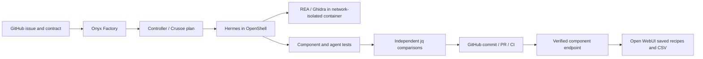

# AYA

AYA recovers a bounded capability from existing software and delivers a tested module into another product.
Onyx is the factory frontend. A GitHub issue names the target repository and its versioned contract.

The current example ports **Fireworks SQL tools into a Crusoe repository analyst**.
[Demo and architecture](DEMO.md) explains the workflow, evidence, provider research, and fine-tuning scope.
The live request is [Crusoe Developer Hub #1](https://github.com/Ali-Maq/crusoe-developer-hub/issues/1).

The first completed target is **Saved JSON Export Recipes for Open WebUI**.
Hermes inspects the installed jq 1.8.2 library through REA and Ghidra.
It then writes a Python component and tests inside OpenShell, using Crusoe inference.
The delivered component has no jq runtime dependency.

## Open the demo

- Factory: <http://localhost:3021/app/factory>
- Target product: <http://localhost:3032>
- Feature request: <https://github.com/Ali-Maq/aya-data-recipes/issues/1>
- Target code and CI: <https://github.com/Ali-Maq/aya-data-recipes>

These URLs use a separate demo profile. Existing local applications and their data are preserved.
Sign in with the demo accounts configured on this machine. Credentials are excluded from Git.

## Verified demonstration

Run `91ae22817df040e7` completed on October 17, 2026, in 8 minutes and 10 seconds.
It used real Crusoe responses, native Hermes sessions, REA decompilation, jq execution, and GitHub Actions.

| Gate | Observed result |
|---|---|
| First candidate | 207/210 independent checks; delivery blocked |
| Agent repair | 210/210 development checks |
| Fresh held-out seed | 210/210 checks |
| Target test suite | 62 tests, including 57 agent-written tests |
| GitHub delivery | [Generated PR and CI](https://github.com/Ali-Maq/aya-data-recipes/pull/2) |
| Product export | Real CSV download; exact bytes checked |
| Persistence | Saved recipe reused after reload in a new chat |
| File access | Another signed-in user received HTTP 404 for the exported file |

The first candidate mishandled scalar records, empty columns, and non-scalar fallbacks.
These were actual failures caught outside the agent's test suite.
Hermes repaired them and retained its own red/green test output.

[Run records](demo/evidence/91ae22817df040e7) include the rejected cases, verification seeds, native agent lineage, and downloaded CSV bytes.
They document the completed run. Live builds do not read them or substitute them for service calls.
The component digest is `58962c252d7c35a92ee45f0ca7bb7f41b2dfa64e52c819d98f94cf60dbf503bf`.

## What the run does



1. Read the issue from GitHub. Freeze its body, contract digest, and target commit.
2. Call Crusoe to plan the investigation. Retain the response identity and usage.
3. Run the installed NemoHermes worker. Require actual REA decompilation calls and retained binary evidence.
4. Let Hermes write the component and its tests. Use native delegation for one focused review.
5. Compare valid cases with the pinned jq executable. Check invalid cases against the application contract.
6. Give the worker failed development cases, with at most two repair attempts.
7. Evaluate a fresh random seed after repair ends. Keep expected answers outside the worker.
8. Recheck GitHub freshness. Commit only the allowed module, its tests, and the controller's verification receipt.
9. Create a pull request. Require successful CI for the exact delivered commit.
10. Activate that source hash in the local product runtime. Each export runs in a fresh restricted container.

The interface displays real run records. A failure stays failed. GitHub or inference failures have no fixture fallback.

## Three-minute demonstration

Start one complete build before the presentation. Keep its real PR, CI, evidence, and module available.
A fresh build can exceed three minutes; do not present retained results as a new run.

- **0:00–0:30:** Open the live GitHub issue from Onyx. Show the target and pinned contract.
- **0:30–1:10:** Show the completed investigation, REA evidence, actual agent lineage, and independent test counts.
- **1:10–1:40:** Open the generated PR and successful CI. Explain the source hash used by the runtime.
- **1:40–2:40:** In Open WebUI, select the AYA JSON Recipes model. Upload JSON, save a recipe, and download CSV.
- **2:40–3:00:** Reuse the saved recipe on a new upload. Start another real factory run if time permits.

The useful edge case is false versus zero. jq's default operator replaces false and null, but preserves zero.
CSV quoting, missing fields, nested paths, Unicode, and NUL escaping expose additional behavior that a happy-path example misses.

## Local services

| Service | Address | Purpose |
|---|---|---|
| Onyx frontend | localhost:3021 | Existing application shell, login, and Factory view |
| Onyx backend | localhost:8082 | Existing authentication and application API |
| Factory controller | 127.0.0.1:8771 | Token-protected intake and jobs |
| Component runtime | 127.0.0.1:8772 | Separate token; export operation only |
| Open WebUI | localhost:3032 | Real upload, per-user recipes, and CSV downloads |
| REA MCP proxy | 127.0.0.1:8766 | Host protocol bridge to container stdio |
| REA TLS bridge | private host:8444 | Trusted CA and token for native Hermes MCP |

The worker is `aya-feature`. It was provisioned with the installed NemoClaw CLI and the existing corporate CA.
Its provider is Crusoe, model `deepseek-ai/DeepSeek-V4-Pro`.
The feature owns this sandbox; repeated runs use new work directories within it.

## Restart the configured demo

Use separate terminals for long-running processes. Check for an existing listener before starting another copy.
From this directory:

```sh
docker compose --env-file .env -f deployment/compose.yml up -d
bash deployment/run-rea.sh
python3 -m aya_factory.server
```

The REA TLS bridge uses `deployment/Caddyfile`. Set `REA_MCP_HOST`, `REA_MCP_TOKEN`, and `REA_CADDY_DATA` from local configuration.
Use the existing REA CA storage. Do not disable certificate validation.

Start the Onyx frontend from the repository's `web` directory:

```sh
bun install --frozen-lockfile
bun run dev --port 3021 --hostname 127.0.0.1
```

Its local environment must contain `INTERNAL_URL=http://127.0.0.1:8082`, `AYA_FACTORY_URL=http://127.0.0.1:8771`, and `AYA_FACTORY_TOKEN`.
Use the same factory token as the controller. The browser receives neither that token nor the Crusoe key.
The controller reads `CRUSOE_API_KEY` or the macOS Keychain item named `crusoe-api-key`.

Build the contained analysis image from the installed Ghidra distribution:

```sh
mkdir -p .cache/analysis-image
cp -R /opt/homebrew/opt/ghidra/libexec .cache/analysis-image/ghidra
docker build -t aya-rea:6.5.0 -f deployment/Dockerfile.rea .cache/analysis-image
```

To reinstall the reviewed product adapter and Crusoe model, run `python3 -m aya_factory.connect_product`.
The command uses the local demo administrator session or prompts for an existing demo login.

The reference directory contains only the pinned jq executable and libjq library.
Their hashes are declared in the target contract and checked by the evaluator.
The image needs the full JDK, procps, and the Linux ARM64 Ghidra decompiler.

## Checks

From this directory, with Python 3.12, authenticated `gh`, and Docker:

```sh
python3 -m unittest discover -s tests -v
```

These checks use actual GitHub requests, actual jq behavior, and a deliberately nonterminating candidate in a container.
The target repository runs both public contract tests and the generated agent tests in GitHub Actions.
Run the Onyx pre-commit hooks for changed files before publishing frontend changes.

## Boundaries and scope

- The first evaluator accepts one reviewed contract revision in one allowlisted target repository.
  Additional capabilities need their own contract review and independent evaluator.
- The candidate cannot edit the controller, acceptance tests, credentials, workflow, or product adapter.
- REA runs without network access, host home access, or a Docker socket. Its reference mount is read-only.
- Candidate execution runs without network access, capabilities, writable root storage, or host mounts.
- OpenShell reports Landlock unavailable on this Docker Desktop host. A Landlock boundary is not claimed.
- Agent sessions have turn, depth, concurrency, and time limits. Code cells have a 45-second timeout. Aggregate token usage is measured, not hard-capped.
- The task can improve through test-driven repair. Model weights do not change, and cross-task self-improvement is not demonstrated.
- Ghidra uses symbols from a benign open-source library. This is not evidence of general recovery from stripped commercial binaries.
- The frontend is a local development build. This profile is not a public multi-tenant production deployment.

The distinction is the enforced delivery protocol and its evidence.
Other coding agents can use the same protocol. No unsupported comparison claims that they must fail.

Onyx's original source, license, and Git history remain in this fork.
REA, Hermes, OpenShell, Ghidra, jq, and Open WebUI retain their own licenses and attribution.

## Prepare the SQL reference

From `aya/`, run `python -m aya_factory.prepare_sql` with Python 3.12, GitHub CLI authentication, and network access. This downloads pinned Fireworks files, checks their digests, copies the replay harness, and fetches actual GitHub metadata. The existing REA container reads `.state/reference` through its read-only mount. Run preparation before a factory build, never during one.

The generated cookbook is portable: its `run.py` accepts a question and reads `CRUSOE_API_KEY` from the environment. The browser demo uses the same client and the accepted SQL module in a restricted executor. The public fork preserves Crusoe's original repository and licenses.
